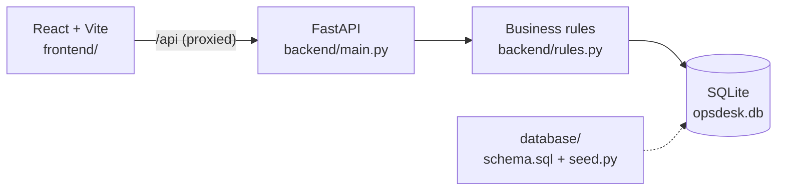

# OpsDesk

**Travel-aware ticketing for TBO.** OpsDesk treats a support ticket as part of a booking story (agency, booking ID, check-in date, last cancellation date), not as an isolated task.

Built for **TBO Hackathon 2026** by Aniruddh (backend) and Nandini (frontend and database).


<!-- Add a screenshot or demo link before submitting:

Demo video: <link>
-->

---

## Why OpsDesk

Generic helpdesks route, escalate and run SLA timers well, but none of them understand a travel agency's world. In the vendor documentation we reviewed (Zendesk, Freshdesk, Jira Service Management), agency, booking ID (TBOH), check-in date and LCD are not built-in concepts. Reaching the same result there takes higher plans, add-ons or custom rules. OpsDesk builds that travel context in.

| Problem | How OpsDesk solves it |
|---|---|
| 1. Context and linking | Tickets with the same TBOH, or the same agency and intent, are linked automatically. |
| 2. Routing and ownership | Routes by availability, shift, region and open load, and saves a visible "why routed" reason. |
| 3. Side conversations | Each thread keeps its own recipients, so transferring a ticket never changes them. Internal and external threads are kept distinct. |
| 4. SLA and escalation | The SLA clock runs to the earlier of check-in and LCD, adjusted by priority. Escalation to the Escalation Manager is one action and shows on the timeline. |
| 5. Insights | Top themes with counts and sample tickets. |
| 6. Data access | Role-checked API, CSV export streamed with no row cap, and a documented scale path. |

---

## Features

- **Ticket queue** with search, views for my queue, unassigned, at-risk and breached tickets, filters by region, intent and priority, and SLA badges (on track, at risk, breached) with hours left.
- **Ticket detail** with booking context, linked tickets, conversation, side conversations and an activity timeline.
- **New ticket form** with intent auto-suggest from the description (`/api/suggest`).
- **Actions** to escalate, transfer to another agent, and change status. Hidden for requesters and enforced by the API.
- **Notifications** panel listing escalated, breached and at-risk tickets. Click one to open it.
- **Smart Routing** view showing the assignment rules and each agent's live workload.
- **Side Conversations** inbox across all tickets, and an **Escalation Queue** for the Escalation Manager.
- **Insights and Analytics** with ticket totals, top themes, an SLA overview, a time-period filter (all time, last 7 or 30 days) and CSV export.
- **Demo user switcher** to see the app as a requester, agent or manager.
- **Readable interface**: larger text, full ticket titles, and clear loading, empty and error messages.

---

## Architecture



`main.py` only turns HTTP into function calls. Every business rule (routing, SLA, escalation, permissions) lives in `rules.py`, and the backend is the source of truth for permissions and ticket visibility. The frontend never decides who may see what.

---

## Tech stack

| Layer | Technology |
|---|---|
| Frontend | React, Vite |
| Backend | Python, FastAPI, Uvicorn, Pydantic |
| Database | SQLite (single file, survives page refreshes) |
| Tests | pytest, httpx |

---

## Project structure

```
opsdesk/
├── README.md              This file
├── .gitignore
├── backend/               API, business rules, tests
│   ├── main.py            Routes and request validation
│   ├── rules.py           Routing, SLA, escalation, permissions
│   ├── db.py              Connection, schema and seed loading
│   ├── test_backend.py    Tests
│   ├── requirements.txt
│   └── .env.example
├── frontend/              React + Vite interface
│   ├── index.html
│   ├── vite.config.js     Proxies /api to the backend
│   ├── package.json
│   └── src/
│       ├── main.jsx
│       ├── styles.css
│       └── readability.css   Larger text and layout fixes (loaded after styles.css)
├── database/              schema.sql and seed.py (used by the backend if present)
└── docs/                  Database notes, demo script, competitor research
```

---

## Quick start

You need **Python 3.10+** and **Node.js 20+**. Run the backend and frontend in two terminals.

### 1. Backend

```bash
cd backend
python -m venv .venv
.venv\Scripts\activate          # Windows   (Mac/Linux: source .venv/bin/activate)
pip install -r requirements.txt
uvicorn main:app --reload
```

- API docs: http://127.0.0.1:8000/docs (try every endpoint here).
- The first start creates `backend/opsdesk.db` and fills it with demo data.
- To start fresh, stop the server and delete `opsdesk.db`.
- Optional settings go in `backend/.env` (copy `.env.example`). The file is never committed.

### 2. Frontend

```bash
cd frontend
npm install
npm run dev
```

Open the URL Vite prints (normally http://localhost:5173). Vite forwards `/api` requests to `http://127.0.0.1:8000`, so no CORS setup is needed for local development.

### 3. Run the tests

```bash
cd backend
pytest -q
```

---

## Demo accounts

There is no password in this hackathon build. Use the user switcher in the header, or pass the `id` as `user_id` to the API.

| id | Name | Role | Sees |
|---|---|---|---|
| 1 | Priya Nair | Requester (Sunrise Travels) | Own agency only |
| 2 | Rahul Verma | Requester (Globe Trotters) | Own agency only |
| 3 | Aarav Mehta | Agent (North) | All tickets |
| 4 | Sneha Iyer | Agent (South) | All tickets |
| 5 | Kabir Singh | Agent (West) | All tickets |
| 6 | Meera Joshi | Agent (West, unavailable) | All tickets |
| 7 | Dev Malhotra | Escalation Manager | Escalated or own tickets |

---

## Five-minute demo

| Journey | What to do | What you see |
|---|---|---|
| **A. Context and linking** | Open a refund ticket that shares a TBOH with other tickets. | Linked tickets appear; the intent shows as refund. |
| **B. Routing** | Create a new urgent ticket. | It gets an agent and a visible "Why routed" reason. |
| **C. Side conversation** | Open a ticket with a supplier thread, then transfer it to another agent. | The thread's recipients stay the same. |
| **D. SLA and escalate** | Open a ticket close to check-in or LCD, then click Escalate. Log in as Dev Malhotra. | Red or amber SLA badge; the ticket is in his queue and on the timeline. |
| **E. Insights and data** | Open Insights, then export. | Top themes with sample tickets; a CSV downloads. |

---

## How the rules work

- **Linking.** Ticket detail returns `linked[]`: tickets with the same TBOH, or the same agency and intent.
- **Routing.** A new ticket goes to an agent who is (1) available, (2) on shift now, (3) in the ticket's region, then (4) has the lowest open load. The reason is saved in `route_reason`.
- **Side conversations.** Each thread stores its own recipients. External threads need valid email recipients.
- **SLA.** `breached` once the earlier of check-in and LCD has passed. `at_risk` inside the priority limit: Urgent 96h, High 72h, Normal 48h, Low 24h.
- **Escalation.** Moves the ticket to the Escalation Manager, sets status `Escalated`, and writes a timeline event. Every ticket change writes an event.
- **Insights and export.** `/api/insights` returns theme counts with sample ticket ids. `/api/export` streams every row as CSV, with no cap.

---

## API

| Method and path | Send | Get back |
|---|---|---|
| GET `/api/users` | | users |
| GET `/api/tickets?user_id=` | optional `region`, `intent`, `unassigned`, `assignee` | tickets, most urgent first |
| POST `/api/tickets` | title, description, agency, tboh, priority, region, intent, check_in, lcd, user_id | `{id}` |
| GET `/api/suggest?text=` | text | `{intent}` |
| GET `/api/tickets/{id}?user_id=` | | ticket + `linked[]` + `events[]` + `side[]` |
| POST `/api/tickets/{id}/escalate` | user_id, reason | `{ok}` |
| POST `/api/tickets/{id}/assign` | user_id, agent_id | `{ok}` |
| POST `/api/tickets/{id}/status` | user_id, status | `{ok}` |
| POST `/api/tickets/{id}/side` | user_id, kind, recipients[], body | `{ok}` |
| GET `/api/insights?user_id=` | | `[{theme, n, sample_ids}]` |
| GET `/api/export?user_id=` | | CSV |

For POST calls, `user_id` can go in the JSON body or in the URL (`?user_id=`). Ticket priority is one of Low, Normal, High, Urgent. Status is one of New, Open, Pending, Escalated, Resolved, Closed.

---

## Security and data

- Every endpoint except `/api/users` and `/api/suggest` needs `user_id` and is checked against the user's role. The API returns **403** when the action is not allowed and **404** for an unknown ticket.
- Requesters see only their own agency's tickets and cannot assign, escalate or change status. A requester's timeline hides internal events and the routing reason.
- Input is validated (empty titles, bad dates, unknown status or priority are rejected) and SQL uses `?` placeholders only.
- No secrets in code. Private settings live in `backend/.env`, which is git-ignored.
- All demo data is synthetic.

---

## Assumptions

- Login is a demo user picker, not real authentication.
- Dates without a time mean the start of that day. Times without a zone are India time (UTC+05:30).
- Agents see every ticket. Requesters see their agency. Managers see escalated tickets and their own.
- Requesters can create tickets for their own agency and add external side conversations.
- If `database/schema.sql` or `database/seed.py` exists, the backend uses it instead of the built-in ones.

## What was cut

- Real login and passwords.
- Email sending (external side conversations are stored, not sent).
- Editing or deleting tickets.
- Pagination on the ticket list.

## Scale path

- Move SQLite to PostgreSQL and add indexes on `tickets(tboh)`, `tickets(agency, intent)`, `tickets(assignee)`, `events(ticket_id)` and `side(ticket_id)`.
- Use read replicas for reports, and a queue or webhooks for near-real-time sync.
- For very large exports: paginate by id, export in chunks, or run a scheduled export job.
- Retention: the demo keeps every ticket. In production, move tickets closed for more than 180 days into a `ticket_archive` table that stays queryable and exportable.

---

## Project status

| Area | Status |
|---|---|
| Backend API, rules, role checks, tests | Done |
| Frontend screens (queue, detail, create, routing, conversations, escalations, insights) | Done |
| Frontend and backend connected through the Vite proxy | Done |
| `database/schema.sql` and `database/seed.py` | In progress (Nandini) |
| `docs/database.md` and `docs/demo-script.md` | To do |
| Screenshots in `docs/screenshots/` | To do |

## Changelog

**Integration and interface polish (November 2026)**

- Redesigned the frontend interface with a light, airy theme, centered page layouts, uniform rounded dropdowns, and high-contrast action buttons.

- Connected the React frontend to the FastAPI backend and checked every screen against real data.
- Increased text sizes across the app and widened the ticket title column so titles are no longer cut off.
- Fixed the required-field stars on the New Ticket form so they sit next to their labels.
- Insights: the period selector is now a working dropdown (all time, last 7 days, last 30 days).
- Insights: Export CSV now downloads reliably and confirms with a message.
- Ticket Detail in the sidebar now opens a ticket instead of returning to the queue.
- Error messages now disappear on their own instead of staying on screen.
- Switching demo user clears the open ticket, so one user's ticket is never shown to another.

**Repository cleanup**

- Merged the backend and frontend READMEs into this one file and removed the duplicate.
- Moved the competitor research into `docs/`.
- Updated `.gitignore` (build output) and made the CORS line in `backend/.env.example` optional.

**Foundation**

- FastAPI + SQLite backend with automatic linking, region and availability routing with a visible reason, side conversations that keep their recipients on transfer, SLA and escalation, insights, and a streaming CSV export.

---

## Docs

- `docs/database.md`: tables, retention and scale notes
- `docs/demo-script.md`: step-by-step demo
- `docs/competitor-research.pdf`: how Zendesk, Freshdesk and Jira Service Management compare on the six problems

## Team

| Person | Owns |
|---|---|
| Aniruddh | Backend: API, business rules, security, tests |
| Nandini | Frontend: screens and states. Database: schema, seed data |
| Both | README, demo script, docs |
