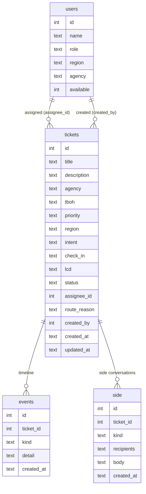

# OpsDesk database notes

OpsDesk stores everything in **SQLite**, a single file at `backend/opsdesk.db`. There is nothing to install. The backend creates the file and fills it with demo data the first time it starts.

The exact table definitions live in code: `backend/db.py` (built-in schema and seed) or, if they exist, `database/schema.sql` and `database/seed.py`, which the backend uses instead. This page explains the design and answers the questions from the brief.

---

## Tables

The column lists above match what the API returns. Check `backend/db.py` for anything beyond them.

| Table | Purpose |
|---|---|
| `users` | Demo accounts. `role` is `requester`, `agent` or `manager`. `agency` is filled for requesters. `available` and shift hours feed routing. |
| `tickets` | One row per ticket. `tboh` is the booking ID, `check_in` and `lcd` drive the SLA, `route_reason` stores why routing chose the assignee. |
| `events` | The activity timeline. Every change to a ticket writes a row, so the history is complete. |
| `side` | Side conversations. Each thread stores its own `recipients` (comma-separated emails), so transferring a ticket never changes them. |

**Allowed values**

- `priority`: Low, Normal, High, Urgent
- `status`: New, Open, Pending, Escalated, Resolved, Closed
- `side.kind`: `internal` or `external`
- Dates are stored as ISO text with the India offset, for example `2026-11-13T09:38:09+05:30`.

**How linking works without a links table.** Related tickets are found by query: the same `tboh`, or the same `agency` and `intent`. Nothing extra is stored, so the links can never go stale.

---

## Demo data

The seed creates:

- Two agencies (Sunrise Travels and Globe Trotters), each with a requester account.
- Agents in North, South and West, one of them unavailable, to prove that routing respects availability.
- Eight tickets across priorities, regions and intents, including two tickets on the same booking (`TBOH-10231`), one ticket close to its deadline, tickets whose deadline has passed, and one escalated ticket.
- Check-in dates and creation times are generated **relative to the moment the database is first created**, so the demo shows at-risk tickets whenever it is started.

To start with fresh dates, stop the backend, delete `backend/opsdesk.db`, and start it again.

---

## Questions from the brief

| Question | Answer |
|---|---|
| Does data survive a page refresh? | Yes. SQLite writes to a file, and the backend only seeds when the database is empty. |
| Can export go past a 3,000-row cap? | Yes. `/api/export` streams every row as CSV in chunks of 200, with no cap. For very large data: paginate by id, export in chunks, or run a scheduled export job. (The 3,000-row cap is the brief's wording, not a verified claim about any vendor.) |
| How would this scale? | Move SQLite to PostgreSQL, add indexes on `tickets(tboh)`, `tickets(agency, intent)`, `tickets(assignee_id)`, `events(ticket_id)` and `side(ticket_id)`, use read replicas for reports, and a queue or webhooks for near-real-time sync. |
| Retention and archiving? | The demo keeps every ticket. A production approach: move tickets closed for more than 180 days into a `ticket_archive` table that stays queryable and exportable. This is a design idea and is not built yet. |
| Privacy? | All data is synthetic. There are no real names, emails or passports anywhere in the project. |

---

## Rules for changing the schema

- Adding a column or table is fine. Update this page and tell the backend owner.
- Renaming or removing a column breaks the API and the screens. Agree on it first.
- The database file is git-ignored on purpose. Share changes through `schema.sql` and `seed.py`, never through the `.db` file.
